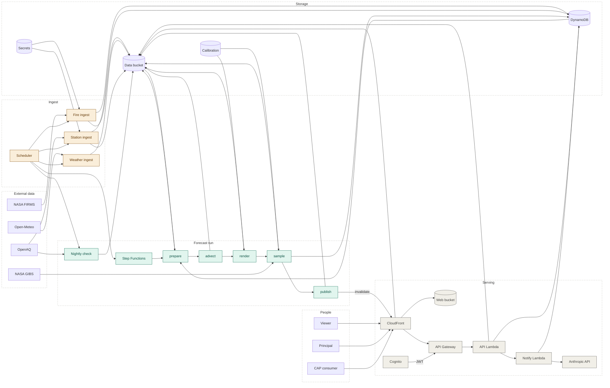
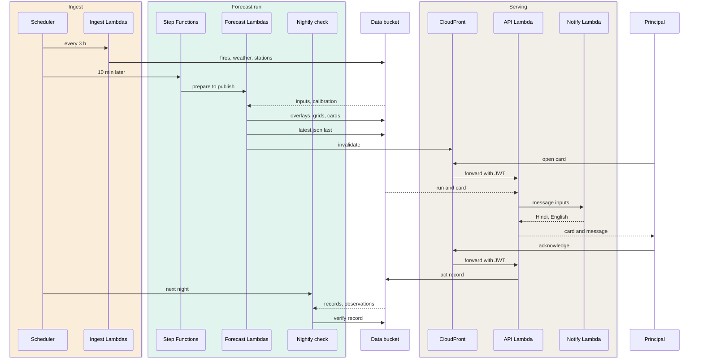

<p align="center">
  <picture>
    <source media="(prefers-color-scheme: dark)" srcset="web/public/brand/logo-dark.png" />
    
  </picture>
</p>

<p align="center"><strong>Tomorrow's stubble smoke, as a decision.</strong></p>

<p align="center">
A 5 km, hourly, 48-hour forecast of the stubble-fire increment to PM2.5 over Punjab, Haryana, Delhi, Rajasthan and western UP —
delivered to the schools, residents' associations, district offices and hospitals downwind of it, and checked against the stations the next day.
</p>

<p align="center">
  <a href="https://d3mp6hbfwg9kx1.cloudfront.net"></a>
  <a href="https://github.com/kartikangiras/mordor/actions/workflows/ci.yml"></a>
  <a href="LICENSE"></a>
  
  
  
</p>

<p align="center">
  <a href="#what-it-does">What it does</a> ·
  <a href="#how-it-works">How it works</a> ·
  <a href="#quick-start">Quick start</a> ·
  <a href="#configuration">Configuration</a> ·
  <a href="#deployment">Deployment</a> ·
  <a href="#testing">Testing</a> ·
  <a href="#contributing">Contributing</a> ·
  <a href="#security">Security</a>
</p>

---

Every October the paddy stubble of Punjab burns and the smoke reaches Delhi a day later. Mordor
forecasts that smoke — the fire increment on top of the regional background — on a 5 km grid,
hour by hour, two days ahead, and turns it into something a principal, a colony secretary, a
district officer or a hospital can act on by 6:30 the next morning. Every number on screen says
where it came from; the model's fit against monitoring stations is on every card.

Built at the WeMakeDevs × AWS *Environmental Hacks* hackathon (Bharat Builds Tour, Track 01 — Air), 8–11 October 2026.

<p align="center"></p>

## What it does

```
PM2.5_total(x, t) = PM2.5_background(x, t)   CAMS via Open-Meteo, ~40 km — consumed
                  + PM2.5_fire(x, t)         ours, 5 km — NASA FIRMS fires carried by 925 hPa winds
```

We claim skill on the second term only, and say so.

### Two identities, one map

**Public — no account.**
The forecast with a time slider; fires, burn risk, crop cover, wind, stations, exposure zones;
a six-chapter story that explains the day; every school coloured by tomorrow's tier; per-tier
*what to do today*; the validation report; and every decision anyone has made, readable by all.

**People who act — sign in.**
A principal, a residents' association secretary, a district agriculture officer or a hospital's
medical superintendent gets a card for tomorrow: the hours of concern, a protocol anchored to
CAQM's GRAP stages, actions to log, a parent / resident / ward message drafted by an agent, and an
assessment of what the chosen actions protect. An air-quality officer approves registrations and
confirms outcomes against the nearest station; the Directorate accounts the impact. Each step
leaves a plain record.

On the demo stack an **eight-step walkthrough** plays one bad day with seven fictional people —
survey, register, approve, plan, act, check, impact, health — against the live forecast, writing
real records.

<p align="center"></p>

### Features

| | |
|---|---|
| **Forecast** | 5 km Lagrangian transport of VIIRS fire detections on 925 hPa winds, 48 h, every 3 h; CAMS background; one fitted scaling constant |
| **Honest numbers** | Split-conformal 90 % intervals on every hour and on the peak; inhaled-dose estimate for the school day; next-day hindcast against stations, published |
| **Cards** | Tiered protocol per actor type (school, residents' association, district office, hospital), default actions, hours of concern |
| **Messages** | Hindi + English, drafted by a Strands agent on the Anthropic API, validated in code (length, no alarm words, a concrete time), template fallback |
| **Choice assessment** | Each action covers a share of the hours at risk; the people-hours protected and exposed follow the choice, with three sentences from the model |
| **Records** | Register → forecast → advise → act → check → impact; contact-free; public; the impact is credited only when the station confirmed the day |
| **Interop** | OASIS CAP 1.2 feed per entity (`/api/cap/{id}`), per-school public pages, voice reading, colour-blind palette |
| **Map** | MapLibre over keyless imagery and vector tiles; one map instance across routes; mobile bottom sheet |

<p align="center"></p>

## How it works

```
EventBridge (every 3 h) ─▶ ingest FIRMS · Open-Meteo · OpenAQ ─▶ Step Functions
   prepare ─▶ advect (5 km Lagrangian) ─▶ render ─▶ sample (schools, zones, actors) ─▶ publish ─▶ S3
                                                                                           │
CloudFront ◀─ web (React · MapLibre) ◀────────────────────────────────────────────────────┘
     └─ /api/* ─▶ API Gateway (Cognito JWT on every write) ─▶ Lambda (FastAPI) ─▶ DynamoDB
                                                                └─▶ NotifyFn: Strands agent on the Anthropic API
```

<details>
<summary><strong>Architecture</strong> — every component and what talks to what</summary>



</details>

<details>
<summary><strong>Workflow</strong> — a run, a card, a decision, the next-day check</summary>



</details>

**Built on AWS** — Lambda, Step Functions, S3, CloudFront, API Gateway, DynamoDB, Cognito,
EventBridge, Systems Manager, SAM. **Data** — NASA FIRMS (VIIRS), Copernicus CAMS, Open-Meteo,
OpenAQ, NASA GIBS (NDVI), OpenStreetMap. **Agent** — Strands Agents SDK on the Anthropic API
(Claude Haiku 4.5), Amazon Bedrock as the alternative provider.

## Quick start

No AWS account is needed to run the forecast and the web app locally.

```bash
git clone https://github.com/kartikangiras/mordor && cd mordor
cp .env.example .env            # add a NASA FIRMS MAP_KEY; the rest is optional locally

make venv                       # Python 3.12 via uv, dev dependencies
make test                       # 130 tests
make ingest-firms               # real VIIRS fires for the domain → ./.data
make ingest-weather             # Open-Meteo winds + boundary layer + CAMS background → ./.data
make forecast-local HOURS=48    # the particle run: overlays, grids, cards → web/public/dev
make api-dev                    # FastAPI on :8000 with dev auth; vite proxies /api

cd web && npm install && npm run dev      # http://localhost:5173
```

## Configuration

Secrets are read from `.env` locally and from SSM SecureStrings under `/mordor/` in AWS; they
are never in the template and never in git.

| Variable | Where | Purpose |
|---|---|---|
| `FIRMS_MAP_KEY` | `.env` → SSM | NASA FIRMS area API; also the hindcast |
| `OPENAQ_API_KEY` | `.env` → SSM | live station layer and outcome checks |
| `DATA_GOV_API_KEY` | `.env` → SSM | CPCB readings via data.gov.in (optional) |
| `ANTHROPIC_API_KEY` | `.env` → SSM | the message and assessment agent; template text without it |
| `NOTIFY_PROVIDER`, `NOTIFY_ANTHROPIC_MODEL`, `NOTIFY_MODEL_ID` | template | `auto` picks the Anthropic API when the key exists; Bedrock only when asked |
| `VITE_CDN_BASE`, `VITE_API_BASE` | `web/.env` | where the web reads runs and the API |
| `VITE_COGNITO_USER_POOL_ID`, `VITE_COGNITO_CLIENT_ID` | `web/.env` | sign-in |
| `VITE_DEMO_MODE`, `VITE_DEMO_PASSWORD` | `web/.env` | the persona picker and the walkthrough; demo builds only |

`.env.example` and `web/.env.example` list every variable with a comment.

## Deployment

One SAM stack holds everything: the pipeline, the API, the web, the user pool and the schedules
(`infra/template.yaml`).

```bash
tools/put_secrets.sh                      # .env → SSM SecureStrings under /mordor/
sam build && sam deploy --guided          # first time; afterwards: sam build && sam deploy
make web-deploy REGION=us-east-1          # build the SPA, sync to the web bucket, invalidate CloudFront
```

The demo personas are seven Cognito users with a shared password, created on a demo stack with
`tools/demo_users.sh create <password>` and removed with `delete`; records they write carry a
`demo` mark. A production stack never runs `create`.

## Testing

| Check | Command | What it covers |
|---|---|---|
| Lint | `make lint` | ruff over `services/`, `tools/`, `tests/` |
| Python | `make test` | the forecast, protocol, records, notify, API routes (130 tests) |
| Web | `cd web && npm run build` | strict TypeScript, no unused locals, production build |
| Infra | `sam validate --lint --template infra/template.yaml` | the stack |
| Browser | Playwright smoke suites (headless Chrome) | every surface, the actor door and the eight-step walkthrough against a dev server proxied to the live API |

CI runs the first four on every push and pull request, plus a grep for anything shaped like a key.

## Project structure

```
services/
  common/        domain, grid, AQI tiers, storage, DynamoDB, SSM secrets
  ingest_*/      FIRMS, Open-Meteo, OpenAQ / CPCB
  forecast/      the particle model and the Step Functions steps
  render/        overlays and grids per hour
  sample/        schools, zones and actors sampled from the run; the cards
  protocol/      tiers, actor types, intervals, dose, the choice assessment, CAP
  records/       the decision records, outcome checks, impact accounting
  notify/        the message and assessment agents, validator, templates
  api/           FastAPI routes, Cognito principal
  zones/         exposure zones, burn-risk cells, NDVI
infra/           AWS SAM template
web/             Vite · React · TypeScript · MapLibre · Tailwind
tools/           hindcast, seeding, secrets, demo users, backdrops
tests/           pytest
data/            static inputs and the latest validation report
```

## Limitations

A simplified Lagrangian transport model: no chemistry, no vertical structure, one fitted scaling
constant whose fit quality is shown in the app. VIIRS sees fires twice a day; fires that start
and finish between overpasses are invisible. Impact is credited only for days the nearest
station confirmed; the rest stays provisional. **Not for medical decisions.**

## Roadmap

- Sentinel-2 NDVI / NBR at 10 m for field-level burn scars (VIIRS at 375 m today)
- Tile pyramid for the plume; animated wind particles
- Fitting the particle lifetime and diffusion after the scaling constant
- Administrative-boundary zones and ward-level exposure
- More actor types: construction sites, employers, gig-work platforms

## Contributing

Issues and pull requests are welcome. The ground rules are about provenance and privacy:

- **Never show a number whose provenance you cannot state.** Every figure traces to a run, a
  record or a fitted constant, and the screen says which.
- **Secrets never enter git.** Keys live in SSM; locally in `.env`, which is ignored. CI fails on
  anything shaped like a key.
- **Real people's contact details never enter git.** `data/onboarded.example.json` shows the
  shape; the real file is ignored.
- **The forecast pipeline is sacred.** A change under `services/forecast`, `ingest_*`, `render`
  or `sample` needs a re-run hindcast (`tools/hindcast.py`) and an updated `data/validation/latest`.
- Plain language on public surfaces: no vendor names, model ids or internal codes in viewer copy.

Before opening a pull request run `make lint`, `make test` and `cd web && npm run build`, and
say how you verified the change and what the user sees. Be kind in issues and reviews; this
project follows the spirit of the [Contributor Covenant](https://www.contributor-covenant.org/version/2/1/code_of_conduct/).

## Security

Please do not open a public issue for a vulnerability. Use GitHub's private vulnerability
reporting (**Security → Report a vulnerability**) with what you found and how to reproduce it.
The forecast, the map, the validation report and the decision records (without contact details)
are public by design; API keys and real people's contact details must never be — if you find
either exposed, that is a vulnerability.

## License

Released under the [MIT License](LICENSE).

## Acknowledgements

Fire detections courtesy of NASA FIRMS · background PM2.5 from Copernicus CAMS · winds from
Open-Meteo · stations via OpenAQ · NDVI from NASA GIBS · schools and basemap data © OpenStreetMap
contributors · map tiles by OpenFreeMap · imagery © Esri · page backdrops from NASA Worldview (GIBS), public
domain. Built on AWS with the Strands Agents SDK.
Not affiliated with or endorsed by NASA, Amazon or AWS.
