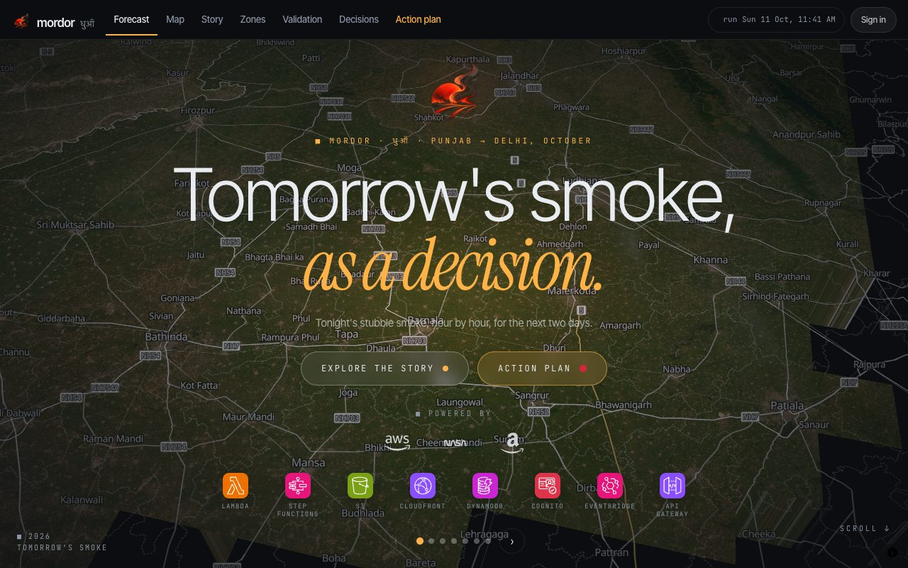
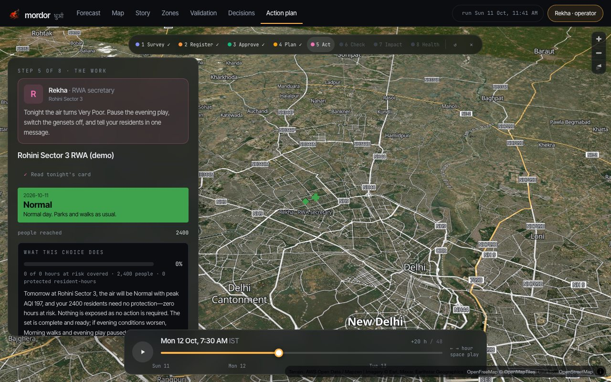
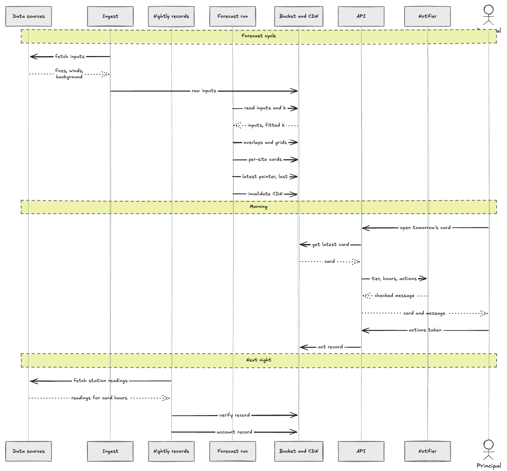
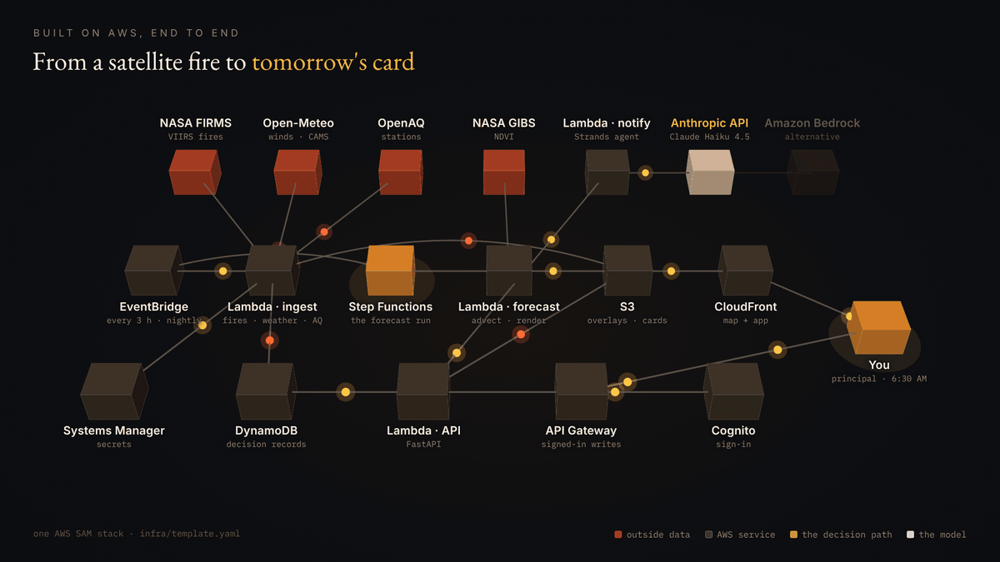
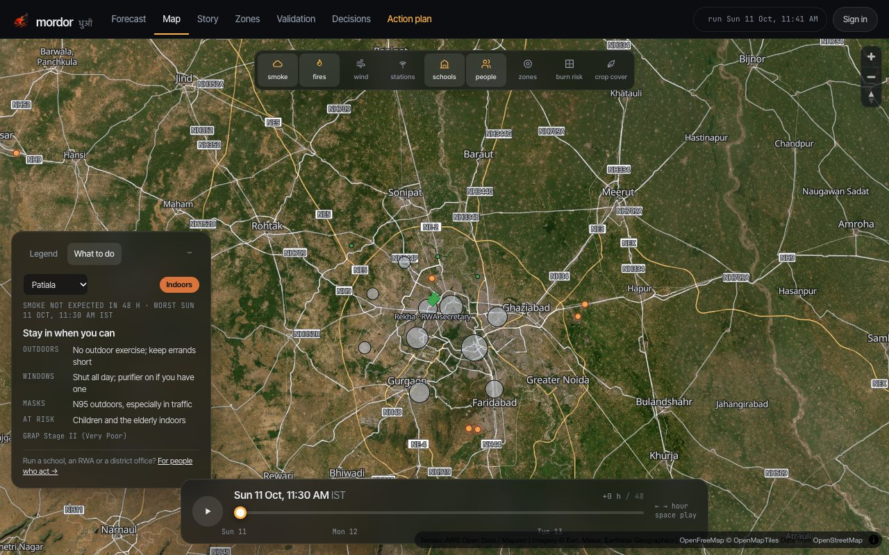

<p align="center">
  <picture>
    <source media="(prefers-color-scheme: dark)" srcset="web/public/brand/logo-dark.png" />
    
  </picture>
</p>

<p align="center"><strong>Tomorrow's stubble smoke, as a decision.</strong></p>

<p align="center">
A 5 km, hourly, 48-hour forecast of the stubble-fire increment to PM2.5 over Punjab, Haryana, Delhi, Rajasthan and western UP —
delivered to the schools, residents' associations, district offices and hospitals downwind of it, and checked against the stations the next day.
</p>

<p align="center">
  <a href="https://d3mp6hbfwg9kx1.cloudfront.net"></a>
  <a href="https://github.com/kartikangiras/mordor/actions/workflows/ci.yml"></a>
  <a href="LICENSE"></a>
  
  
  
</p>

<p align="center">
  <strong>Live demo:</strong> <a href="https://d3mp6hbfwg9kx1.cloudfront.net">d3mp6hbfwg9kx1.cloudfront.net</a> ·
  <strong>Try the walkthrough:</strong> <a href="https://d3mp6hbfwg9kx1.cloudfront.net/act/walk">/act/walk</a> ·
  <strong>Demo film:</strong> TODO(kartik): YouTube link ·
  <strong>Architecture:</strong> <a href="docs/architecture.md">docs/architecture.md</a> ·
  <strong>Validation report:</strong> <a href="data/validation/latest/report.json">report.json</a> ·
  <strong>Run locally:</strong> <code>make venv && make test</code>
</p>

<p align="center">
  <a href="#try-it-in-two-minutes-no-account">Try it</a> ·
  <a href="#what-it-does-in-one-bad-day">What it does</a> ·
  <a href="#where-aws-fits">Where AWS fits</a> ·
  <a href="#why-you-can-trust-the-numbers">Trust</a> ·
  <a href="#features">Features</a> ·
  <a href="#run-it">Run it</a> ·
  <a href="#built-to-be-run">Built to be run</a> ·
  <a href="#testing">Testing</a> ·
  <a href="#contributing">Contributing</a> ·
  <a href="#security">Security</a>
</p>

---

It is about 9 PM on an October evening and you are the principal of a school in Rohini, Delhi.
The paddy fields of Punjab are burning tonight, and their smoke reaches Delhi a day later. You
have to decide tonight what happens to tomorrow's morning assembly, the outdoor games period
and the 3 PM dismissal, and the air-quality apps on your phone only say how bad the air is now.
What you need answered is different: will it be bad tomorrow, at which hours, how bad, what
should the school do, and what do you tell the parents?

Mordor answers those questions every three hours. It reads tonight's VIIRS fire detections
from NASA FIRMS, carries the smoke on the wind across a 5 km grid for the next 48 hours, and
adds it to the regional background from CAMS. It turns the result into a card for each school,
residents' association, district office and hospital, ready by 6:30 the next morning, and
drafts the Hindi and English message that goes with it. It logs what each of them did, checks
the card against the nearest monitoring station the next night, and credits impact only for
the days the station confirmed.

Built at the WeMakeDevs × AWS *Environmental Hacks* hackathon (Bharat Builds Tour, Track 01 — Air), 8–11 October 2026.
Everything described here is running code in this repository, covered by 131 tests.

<p align="center"></p>

## Try it in two minutes, no account

1. Open the [live site](https://d3mp6hbfwg9kx1.cloudfront.net).
2. Go to [/act/walk](https://d3mp6hbfwg9kx1.cloudfront.net/act/walk) and read the two opening slides.
3. Press **Begin the walkthrough**.

The walkthrough plays one bad day in eight steps with seven fictional people, against the live
forecast. Each step signs the browser in as that person, so the buttons call the real API and
the records are real writes. The steps and people are `EXP_STEPS` and `PERSONAS` in
[web/src/lib/experience.ts](web/src/lib/experience.ts).

| # | Step | Who | What they do | The record it leaves |
|---|---|---|---|---|
| 1 | The Landscape | Priya, forecast analyst, Mordor | **Load tonight's fire detections** → **Load the vegetation (NDVI)** → pick the area → **Score the burning risk per cell** | none; the step only reads the run |
| 2 | The Community | Anita, principal, Kendriya Vidyalaya, Rohini | pick a school → **Confirm the details** → **Register the school** → **Read tomorrow's card** → **Log tomorrow's actions** | `enrol` (EntityRegistration) from `POST /api/actors/register`, then `act` (ActionReport) from `POST /api/actors/{id}/ack` |
| 3 | The Inspection | Dr. Mehta, air-quality officer, Delhi Pollution Control Committee | tick the three checks (vegetation drop, a station within 25 km, the hours) → **Approve the registration** | `verify` with `subject: registration` from `POST /api/verifier/approve` |
| 4 | The Plan | Gurpreet, district agriculture officer, Sangrur | **Run the predictive model for the area** → **Check the weather window** → **Mark the treatment cells** → **Submit the plan** | `advise` (Advisory) with `subject: plan` from `POST /api/actors/{id}/plan` |
| 5 | The Work | Rekha, RWA secretary, Rohini Sector 3 | **Read tonight's card** → **Confirm the actions** → read the Hindi and English message → **Log the actions** | `act` (ActionReport) from `POST /api/actors/{id}/ack` |
| 6 | The Check | Dr. Mehta again | **Fetch the station readings** → **Confirmed**, **Not confirmed**, **Missed** or **Moot** | `verify` (OutcomeCheck) from `POST /api/verifier/confirm` |
| 7 | The Value | Ms. Rao, deputy director, Directorate of Education | **Compute the impact statements** | `account` (ImpactStatement) per entity from `POST /api/records/account` |
| 8 | The Ward | Dr. Kapoor, medical superintendent, District Hospital, Rohini | **Read tonight's card** → **Alert the respiratory and emergency wards** → **Check inhalers, nebulisers and oxygen** → **Keep beds ready for asthma and COPD** → **Log the preparation** | `act` (ActionReport) from `POST /api/actors/{id}/ack` |

The buttons are in [web/src/components/Experience/steps/](web/src/components/Experience/steps/),
the calls in [web/src/lib/api.ts](web/src/lib/api.ts) and the routes in
[services/api/routes/principal.py](services/api/routes/principal.py). Every record the
walkthrough writes names the persona who wrote it in its `by.persona` field, and the fictional
entities are flagged `demo: true` in [data/actors.demo.json](data/actors.demo.json) and on
their registration records. All of them are readable at
[/records](https://d3mp6hbfwg9kx1.cloudfront.net/records).

<p align="center"></p>

## What it does, in one bad day

```
PM2.5_total(x, t) = PM2.5_background(x, t)   CAMS via Open-Meteo, ~40 km — consumed
                  + PM2.5_fire(x, t)         ours, 5 km — NASA FIRMS fires carried by 925 hPa winds
```

We claim skill on the second term only, and say so.

<p align="center">
  <a href=".github/assets/flowchart.png">
    
  </a>
</p>

The machinery:

```
EventBridge (every 3 h) ─▶ ingest FIRMS · Open-Meteo · OpenAQ ─▶ Step Functions
   prepare ─▶ advect (5 km Lagrangian) ─▶ render ─▶ sample (schools, zones, actors) ─▶ publish ─▶ S3
                                                                                           │
CloudFront ◀─ web (React · MapLibre) ◀────────────────────────────────────────────────────┘
     └─ /api/* ─▶ API Gateway (Cognito JWT on every write) ─▶ Lambda (FastAPI) ─▶ DynamoDB
                                                                └─▶ NotifyFn: Strands agent on the Anthropic API
```

The fire and weather ingests run every three hours and the forecast starts ten minutes after
them; the 00:10 UTC run is 05:40 IST, which is the card a principal reads at 6:30. The station
ingest runs hourly and feeds the live station layer, not the forecast.

<strong>Full AWS map</strong> — every resource and what talks to what:

<p align="center">
  <a href=".github/assets/architecture.gif">
    
  </a>
</p>

The map is wide; open the image for full size.

The same map as Mermaid, the Step Functions definition as a state diagram, the detailed
sequence with the approve, confirm and account steps, the trust boundaries and the list of
what a run writes are in [docs/architecture.md](docs/architecture.md).

### Two identities, one map

**Public — no account.**
The forecast with a time slider; fires, burn risk, crop cover, wind, stations, exposure zones;
a six-chapter story that explains the day; every school coloured by tomorrow's tier; per-tier
*what to do today*; the validation report; and every decision anyone has made, readable by all.

**People who act — sign in.**
A principal, a residents' association secretary, a district agriculture officer or a hospital's
medical superintendent gets a card for tomorrow: the hours of concern, a protocol anchored to
CAQM's GRAP stages, actions to log, a parent / resident / ward message drafted by an agent, and an
assessment of what the chosen actions protect. An air-quality officer approves registrations and
confirms outcomes against the nearest station; the Directorate accounts the impact. Each step
leaves a plain record.

## Where AWS fits

Everything is one SAM stack, [infra/template.yaml](infra/template.yaml). The "Where" column
gives the logical ID in that template and the module it runs.

| Service | Role in mordor | Where |
|---|---|---|
| AWS Lambda | 11 functions on Python 3.12, arm64: the API, the message agent, three ingests, the five forecast steps and the nightly records job | `ApiFn` → [services/api/handler.py](services/api/handler.py) · `NotifyFn` → [services/notify/handler.py](services/notify/handler.py) · `IngestFirmsFn`, `IngestWeatherFn`, `IngestCpcbFn` → `services/ingest_*/handler.py` · `ForecastPrepareFn`, `ForecastAdvectFn`, `ForecastRenderFn`, `ForecastSampleFn`, `ForecastPublishFn` → [services/forecast/steps.py](services/forecast/steps.py) · `RecordsDailyFn` → [services/records/daily.py](services/records/daily.py) |
| AWS Step Functions | the forecast run: prepare → advect → render → sample → publish, with retries and a `failed` state; `latest.json` is written only by the last step | `ForecastSfn` → [infra/statemachine/forecast-run.asl.json](infra/statemachine/forecast-run.asl.json) |
| Amazon EventBridge Scheduler | five schedules: fires and weather every 3 h, stations hourly, the forecast 10 minutes after the ingests, the outcome check at 03:00 IST | the `Events` of `IngestFirmsFn`, `IngestWeatherFn`, `IngestCpcbFn`, `ForecastSfn`, `RecordsDailyFn` |
| Amazon S3 | `DataBucket` holds raw inputs, runs, static data, the validation report and the records; `WebBucket` holds the built web app. Both are private | `DataBucket`, `WebBucket` → [services/common/storage.py](services/common/storage.py) |
| Amazon CloudFront | one distribution in front of the web bucket, the data bucket and the API; a CloudFront Function serves `index.html` for app routes; publishing a run invalidates the latest pointer | `Cdn`, `OriginAccessControl`, `SpaRewriteFunction` → `_invalidate` in [services/forecast/steps.py](services/forecast/steps.py) |
| Amazon API Gateway | one HTTP API; a JWT authorizer on every write route, public GETs through the catch-all | `HttpApi` (authorizer `CognitoJwt`) → [services/api/routes/](services/api/routes/) |
| Amazon Cognito | the user pool for people who act; users are created by an administrator, never by self sign-up; the role and the entity are custom attributes | `UserPool`, `UserPoolClient` → [services/api/auth.py](services/api/auth.py), [web/src/lib/auth.ts](web/src/lib/auth.ts) |
| Amazon DynamoDB | one on-demand table: run status, per-school forecasts, logged actions, the index of decision records, the message cache, fires and station observations | `MainTable` → [services/common/ddb.py](services/common/ddb.py) |
| AWS Systems Manager Parameter Store | API keys as SecureStrings under `/mordor/`, read at cold start. The template grants read access; the parameters are written by a script | `SSMParameterReadPolicy` on `ApiFn`, `NotifyFn`, `IngestFirmsFn`, `IngestCpcbFn` → `secret()` in [services/common/aws.py](services/common/aws.py), [tools/put_secrets.sh](tools/put_secrets.sh) |
| Amazon ECR | one container image (numpy, Pillow) shared by the five forecast functions. The repository is created by `sam deploy`, not declared in the template | [services/forecast/Dockerfile](services/forecast/Dockerfile), `resolve_image_repos` in [samconfig.toml](samconfig.toml) |
| AWS IAM | one execution role per function, scoped to only what it touches: `DynamoDBCrudPolicy`, `S3CrudPolicy`, `SSMParameterReadPolicy` and `LambdaInvokePolicy` from the SAM policy templates, plus two hand-written statements — `bedrock:InvokeModel*` for `NotifyFn` (granted, unused — the deployed path is the Anthropic API) and `cloudfront:CreateInvalidation` for `ForecastPublishFn` | the `Policies` and `Statement` blocks on every function in [infra/template.yaml](infra/template.yaml) |
| AWS X-Ray | tracing is active on every function | `Globals.Function.Tracing` |
| Amazon CloudWatch Logs | every function's logs; level set once | `Globals.Function.Environment.Variables.LOG_LEVEL` → [infra/template.yaml](infra/template.yaml) |
| AWS SAM | builds and deploys the stack | [infra/template.yaml](infra/template.yaml), [samconfig.toml](samconfig.toml) |
| Strands Agents SDK (AWS open source) | writes the Hindi and English message and the three-sentence assessment as structured output, which is then checked in code. It calls Claude Haiku 4.5 (`claude-haiku-4-5-20251001`) on the Anthropic API when the SecureString `/mordor/anthropic_api_key` exists (`NOTIFY_PROVIDER=auto`), and the template text otherwise. Amazon Bedrock on `NOTIFY_MODEL_ID` (`us.amazon.nova-lite-v1:0`) is used only when `NOTIFY_PROVIDER=bedrock` is set explicitly | `NotifyFn` → [services/notify/agent.py](services/notify/agent.py), [services/notify/assess_agent.py](services/notify/assess_agent.py), [services/notify/service.py](services/notify/service.py) |

The template also defines three things that are off unless configured: a USD 20 monthly
`CostBudget` (created only when `BudgetEmail` is set), SES permission for `POST /api/me/email`
(which answers 501 until a sender is stored), and the Bedrock permission for the provider above.

| Source | What | Resolution / cadence | Where ingested |
|---|---|---|---|
| NASA FIRMS | VIIRS active-fire detections from NOAA-20, S-NPP and NOAA-21 (near real time) | 375 m detections; fetched every 3 h; a run uses the last 24 h | [services/ingest_firms/firms.py](services/ingest_firms/firms.py) |
| Open-Meteo | 925 hPa and 10 m wind, boundary-layer height, precipitation | 0.5° nodes over the domain, hourly; fetched every 3 h | [services/ingest_weather/openmeteo.py](services/ingest_weather/openmeteo.py) |
| Copernicus CAMS, via the Open-Meteo air-quality API | background PM2.5, PM10 and NO2 | ~40 km, hourly; fetched every 3 h | [services/ingest_weather/openmeteo.py](services/ingest_weather/openmeteo.py) |
| OpenAQ v3 | live station PM2.5 and PM10 for the map's station layer | hourly | [services/ingest_cpcb/openaq_live.py](services/ingest_cpcb/openaq_live.py), [services/ingest_cpcb/cpcb.py](services/ingest_cpcb/cpcb.py) |
| OpenAQ open-data archive | hourly station history for the hindcast and the outcome checks | hourly values; the archive lags about four days | [tools/hindcast.py](tools/hindcast.py), [services/records/verification.py](services/records/verification.py) |
| NASA GIBS | VIIRS NDVI 8-day composites, for the burn-risk score | 8-day composites; read at each run | [services/zones/ndvi.py](services/zones/ndvi.py) |
| OpenStreetMap | school points | fetched once | [tools/fetch_schools.py](tools/fetch_schools.py) → [data/schools.geojson](data/schools.geojson) |

## Why you can trust the numbers

1. **Every number states where it came from.** Each card carries its run id and the calibration it was built with; each forecast record carries the fire count, the weather fetch, the fitted constant and the seed. [services/common/calibration.py](services/common/calibration.py), [services/sample/entities.py](services/sample/entities.py)
2. **A range, not a guess.** Every forecast hour and the peak hour of concern carry a split-conformal 90 % band. The half-width is 209.7 µg/m³ over all leads (`conformal.q90`): 213.9 for hours 1–24 and 206.4 for hours 25–48 (`conformalByLead`). [services/protocol/interval.py](services/protocol/interval.py), [calibration.json](data/validation/latest/calibration.json)
3. **Checked against the nearest station.** A nightly job at 03:00 IST compares each card's tier with the peak PM2.5 the nearest station within 25 km measured in the hours of concern. A check stays `pending` until the readings are published and is retried for seven days; an air-quality officer can also record the outcome with evidence. [services/records/verification.py](services/records/verification.py), [services/records/daily.py](services/records/daily.py), `RecordsDailyFn` in [infra/template.yaml](infra/template.yaml)
4. **Impact only when the station confirms.** An impact statement is `verified` only when the outcome is `confirmed`; a false alarm or a moot day is `not_credited`; everything else stays `provisional`. [services/records/accounting.py](services/records/accounting.py)
5. **The agent's message is checked in code.** Both languages present, Hindi in Devanagari, at most 400 characters, at most one leading emoji, none of the alarm words, a concrete clock time. A rejected draft gets one retry with the reasons, then the template is used. [services/notify/validate.py](services/notify/validate.py), [services/notify/service.py](services/notify/service.py), [services/notify/fallback.py](services/notify/fallback.py)
6. **Public records, no contact details.** Records are contact-free by construction and stripped again on the way out; phone numbers and emails stay in DynamoDB; the real onboarding file is git-ignored. [services/records/store.py](services/records/store.py), [tools/seed_actors.py](tools/seed_actors.py), [data/onboarded.example.json](data/onboarded.example.json)
7. **Every write is signed in.** Every POST route has the Cognito JWT authorizer at API Gateway and a role check in the handler. Header logins are accepted only when `DemoAuth=1`, which is `0` in [samconfig.toml](samconfig.toml). [services/api/auth.py](services/api/auth.py), `ApiFn` events in [infra/template.yaml](infra/template.yaml)
8. **Secrets never in git.** Keys are SSM SecureStrings; `.env` is ignored; CI fails on anything shaped like a key. [services/common/aws.py](services/common/aws.py), [.github/workflows/ci.yml](.github/workflows/ci.yml)
9. **We say what we don't claim.** Skill is claimed on the fire increment only; the model is a simplified transport model; every run's manifest says it is not for medical decisions; the CAP feed is marked `Exercise`. [services/forecast/steps.py](services/forecast/steps.py), [services/protocol/cap.py](services/protocol/cap.py), [Limitations](#limitations)

### Validation

The hindcast, [tools/hindcast.py](tools/hindcast.py), ran the model once a day over
2025-11-01..2025-11-20, fitted the one scaling constant on the first 10 days and scored the
following 10 against 97 stations, 60 of them in Delhi. The numbers below are from
[report.json](data/validation/latest/report.json) and
[calibration.json](data/validation/latest/calibration.json).

Detection of Very Poor days (`metrics.hitRate`, threshold `AQI >= 301 (Very Poor) daily max,
lead 1-24 h`):

| | Station reached 301 or more | Station stayed below |
|---|---|---|
| **Forecast said 301 or more** | 739 hits | 110 false alarms |
| **Forecast said below** | 45 misses | 34 correct negatives |

Probability of detection 0.94, false-alarm ratio 0.13, accuracy 0.83.

A hit is one station on one test day where both the forecast (CAMS background plus the fire
increment) and the station reached a PM2.5 sub-index of 301 or more in at least one of the first
24 forecast hours. It is counted per station-day, not per hour, and a station-day needs at least
12 paired hours to count. Most station-days in this window were Very Poor or worse, so the
detection rate is the easy half and the 34 correct negatives against 110 false alarms are the
hard half. The report does not compute the same table for CAMS alone.

Hourly PM2.5 on the 10 test days, 42,407 station-hours (`metrics.test`):

| | Model (CAMS + fire increment) | CAMS only |
|---|---|---|
| R² | −0.192 | −0.339 |
| MAE, µg/m³ | 94.9 | 100.0 |
| Bias, µg/m³ | −63.6 | −78.1 |

R² is negative for both, and both read low. The model is closer than CAMS alone on all three.
The fire increment on its own correlates 0.106 with observed minus background
(`metrics.test.incrementCorr`), and on 781 Very Poor events the forecast peak was a median
16.0 hours from the observed one (`metrics.peakTiming`). The hindcast used ERA5 100 m winds
with a 10 m blend; live runs use 925 hPa (`windLevel`).

From the report: "Out-of-sample metrics on days after the fit window. Observations: OpenAQ
open-data archive (hourly PM2.5, station timestamps treated as hour labels, +/-1 h ambiguity).
Background: CAMS global reanalysis/forecast via Open-Meteo (~40 km). Fires: FIRMS area API,
VIIRS_SNPP_SP + VIIRS_NOAA20_SP."

## Features

| | |
|---|---|
| **Forecast** | 5 km Lagrangian transport of VIIRS fire detections on 925 hPa winds, 48 h, every 3 h; CAMS background; one fitted scaling constant |
| **Honest numbers** | Split-conformal 90 % intervals on every hour and on the peak; inhaled-dose estimate for the school day; next-day hindcast against stations, published |
| **Cards** | Tiered protocol per actor type (school, residents' association, district office, hospital), default actions, hours of concern |
| **Messages** | Hindi + English, drafted by a Strands agent on the Anthropic API, validated in code (length, no alarm words, a concrete time), template fallback |
| **Choice assessment** | Each action covers a share of the hours at risk; the people-hours protected and exposed follow the choice, with three sentences from the model |
| **Records** | Register → forecast → advise → act → check → impact; contact-free; public; the impact is credited only when the station confirmed the day |
| **Interop** | OASIS CAP 1.2 feed per entity (`/api/cap/{id}`), per-school public pages, voice reading, colour-blind palette |
| **Map** | MapLibre over keyless imagery and vector tiles; one map instance across routes; mobile bottom sheet |

<p align="center"></p>

## Run it

### Locally, no AWS account

No AWS account is needed to run the forecast and the web app locally.

```bash
git clone https://github.com/kartikangiras/mordor && cd mordor
cp .env.example .env            # add a NASA FIRMS MAP_KEY; the rest is optional locally

make venv                       # Python 3.12 via uv, dev dependencies
make test                       # 131 tests
make ingest-firms               # real VIIRS fires for the domain → ./.data
make ingest-weather             # Open-Meteo winds + boundary layer + CAMS background → ./.data
make forecast-local HOURS=48    # the particle run: overlays, grids, cards → web/public/dev
make api-dev                    # FastAPI on :8000 with dev auth; vite proxies /api

cd web && npm install && npm run dev      # http://localhost:5173
```

### On AWS

One SAM stack holds everything: the pipeline, the API, the web, the user pool and the schedules
(`infra/template.yaml`).

```bash
tools/put_secrets.sh                      # .env → SSM SecureStrings under /mordor/
sam build && sam deploy --guided          # first time; afterwards: sam build && sam deploy
make web-deploy REGION=us-east-1          # build the SPA, sync to the web bucket, invalidate CloudFront
```

The demo personas are seven Cognito users with a shared password, created on a demo stack with
`tools/demo_users.sh create <password>` and removed with `delete`; records they write name the
persona in `by.persona`, and the fictional entities carry `demo: true`. A production stack never
runs `create`.

### Configuration

Secrets are read from `.env` locally and from SSM SecureStrings under `/mordor/` in AWS; they
are never in the template and never in git.

| Variable | Where | Purpose |
|---|---|---|
| `FIRMS_MAP_KEY` | `.env` → SSM | NASA FIRMS area API; also the hindcast |
| `OPENAQ_API_KEY` | `.env` → SSM | live station layer and outcome checks |
| `DATA_GOV_API_KEY` | `.env` → SSM | CPCB readings via data.gov.in (optional) |
| `ANTHROPIC_API_KEY` | `.env` → SSM | the message and assessment agent; template text without it |
| `NOTIFY_PROVIDER`, `NOTIFY_ANTHROPIC_MODEL`, `NOTIFY_MODEL_ID` | template | `auto` picks the Anthropic API when the key exists; Bedrock only when asked |
| `VITE_CDN_BASE`, `VITE_API_BASE` | `web/.env` | where the web reads runs and the API |
| `VITE_COGNITO_USER_POOL_ID`, `VITE_COGNITO_CLIENT_ID` | `web/.env` | sign-in |
| `VITE_DEMO_MODE`, `VITE_DEMO_PASSWORD` | `web/.env` | the persona picker and the walkthrough; demo builds only |

`.env.example` and `web/.env.example` list every variable with a comment.

## Built to be run

| Concern | Where |
|---|---|
| Secrets live in SSM, never in the template or a Lambda environment variable | `secret()` in [services/common/aws.py](services/common/aws.py), [tools/put_secrets.sh](tools/put_secrets.sh) |
| A viewer never sees a half-published run: `runs/latest.json` is written last, and a failed step leaves the last good run in place | `publish` in [services/forecast/steps.py](services/forecast/steps.py), the `Catch` on each state in [infra/statemachine/forecast-run.asl.json](infra/statemachine/forecast-run.asl.json) |
| CloudFront is invalidated on publish, and only for the latest pointer; run objects are immutable | `_invalidate` in [services/forecast/steps.py](services/forecast/steps.py), `CACHE_IMMUTABLE` in [services/common/storage.py](services/common/storage.py) |
| Cognito on every write | the `CognitoJwt` authorizer on the write events of `ApiFn` in [infra/template.yaml](infra/template.yaml), [services/api/auth.py](services/api/auth.py) |
| Demo records are marked | `_by` and `register` in [services/api/routes/principal.py](services/api/routes/principal.py), [data/actors.demo.json](data/actors.demo.json) |
| A slow or failing model cannot take the card down: one call, a 15 s read timeout, then the template | `_invoke_notify` in [services/api/routes/principal.py](services/api/routes/principal.py) |
| Both buckets are private; CloudFront reads only `runs/`, `static/`, `validation/` and `records/` of the data bucket | `DataBucketPolicy`, `OriginAccessControl` in [infra/template.yaml](infra/template.yaml) |
| Raw inputs expire after 45 days and runs after 30 | `LifecycleConfiguration` of `DataBucket` in [infra/template.yaml](infra/template.yaml) |
| CI on every push and pull request: ruff, 131 tests, a strict TypeScript build, `sam validate --lint`, and a grep for anything shaped like a key | [.github/workflows/ci.yml](.github/workflows/ci.yml) |

## Testing

| Check | Command | What it covers |
|---|---|---|
| Lint | `make lint` | ruff over `services/`, `tools/`, `tests/` |
| Python | `make test` | the forecast, protocol, records, notify, API routes (131 tests) |
| Web | `cd web && npm run build` | strict TypeScript, no unused locals, production build |
| Infra | `sam validate --lint --template infra/template.yaml` | the stack |
| Browser | Playwright smoke suites (headless Chrome) | every surface, the actor door and the eight-step walkthrough against a dev server proxied to the live API. TODO(kartik): the suites are not in this repository; add them or drop this row |

CI runs the first four on every push and pull request, plus a grep for anything shaped like a key.

## Project structure

```
services/
  common/        domain, grid, AQI tiers, storage, DynamoDB, SSM secrets
  ingest_*/      FIRMS, Open-Meteo, OpenAQ / CPCB
  forecast/      the particle model and the Step Functions steps
  render/        overlays and grids per hour
  sample/        schools, zones and actors sampled from the run; the cards
  protocol/      tiers, actor types, intervals, dose, the choice assessment, CAP
  records/       the decision records, outcome checks, impact accounting
  notify/        the message and assessment agents, validator, templates
  api/           FastAPI routes, Cognito principal
  zones/         exposure zones, burn-risk cells, NDVI
infra/           AWS SAM template
web/             Vite · React · TypeScript · MapLibre · Tailwind
tools/           hindcast, seeding, secrets, demo users, backdrops
tests/           pytest
data/            static inputs and the latest validation report
docs/            the architecture and the learnings log
```

## Limitations

A simplified Lagrangian transport model: no chemistry, no vertical structure, one fitted scaling
constant whose fit quality is shown in the app. VIIRS sees fires twice a day; fires that start
and finish between overpasses are invisible. Impact is credited only for days the nearest
station confirmed; the rest stays provisional. **Not for medical decisions.**

## Roadmap

- Sentinel-2 NDVI / NBR at 10 m for field-level burn scars (VIIRS at 375 m today)
- Tile pyramid for the plume; animated wind particles
- Fitting the particle lifetime and diffusion after the scaling constant
- Administrative-boundary zones and ward-level exposure
- More actor types: construction sites, employers, gig-work platforms

## Contributing

Issues and pull requests are welcome. The ground rules are about provenance and privacy:

- **Never show a number whose provenance you cannot state.** Every figure traces to a run, a
  record or a fitted constant, and the screen says which.
- **Secrets never enter git.** Keys live in SSM; locally in `.env`, which is ignored. CI fails on
  anything shaped like a key.
- **Real people's contact details never enter git.** `data/onboarded.example.json` shows the
  shape; the real file is ignored.
- **The forecast pipeline is sacred.** A change under `services/forecast`, `ingest_`*, `render`
  or `sample` needs a re-run hindcast (`tools/hindcast.py`) and an updated `data/validation/latest`.
- Plain language on public surfaces: no vendor names, model ids or internal codes in viewer copy.

Before opening a pull request run `make lint`, `make test` and `cd web && npm run build`, and
say how you verified the change and what the user sees. Be kind in issues and reviews; this
project follows the spirit of the [Contributor Covenant](https://www.contributor-covenant.org/version/2/1/code_of_conduct/).
What broke along the way is kept in [docs/LEARNINGS.md](docs/LEARNINGS.md).

## Security

Please do not open a public issue for a vulnerability. Use GitHub's private vulnerability
reporting (**Security → Report a vulnerability**) with what you found and how to reproduce it.
The forecast, the map, the validation report and the decision records (without contact details)
are public by design; API keys and real people's contact details must never be — if you find
either exposed, that is a vulnerability.

## License

Released under the [MIT License](LICENSE).

## Acknowledgements

Fire detections courtesy of NASA FIRMS · background PM2.5 from Copernicus CAMS · winds from
Open-Meteo · stations via OpenAQ · NDVI from NASA GIBS · schools and basemap data © OpenStreetMap
contributors · map tiles by OpenFreeMap · imagery © Esri · page backdrops from NASA Worldview (GIBS), public
domain. Built on AWS with the Strands Agents SDK.
Not affiliated with or endorsed by NASA, Amazon or AWS.
